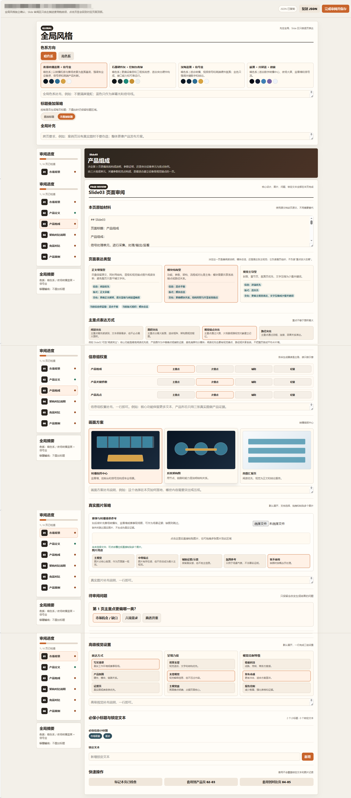

# PPT Image ZLX Workflow

`ppt-image-zlx-workflow` 是一个用于生成 16:9 PPT 图片页的 Codex skill。它适合把 Word、PDF、Markdown、Excel 大纲、结构化页稿或本地图片素材，转成一组风格统一、经过审阅的 PPT 页面图片。

这个 skill 的核心价值不是直接“快出一套图”，而是把 PPT 图片生成拆成可确认、可回退、低返工的流程：先确认内容边界，再用视觉决策网页锁定风格、颜色、页面表达、信息权重和真实图片策略，之后再写页面图像指南、生成样张、批量生成和质检。

> 输出是图片文件，不输出 PPTX/PPT。

## 适用场景

- 需要把长文档、方案材料、研究资料整理成统一风格的 PPT 图片页。
- 页面数量、标题、信息模块需要严格跟随原始材料。
- 需要先让用户审阅视觉方向，而不是一次性生成后再大面积返工。
- 需要处理真实图片素材，并明确它们是主视觉、证据图、示意图、氛围参考，还是暂不使用。
- 需要稳定的标题叠加流程，避免主体图和标题互相冲突。

## 视觉决策网页

流程默认使用 Visual Decision Board。它是一个本地审阅网页，用来集中确认全局风格、每页表达方式、信息权重、真实图片策略、标题输出方式和待确认问题。

下面是真实的视觉决策网页示例：



这个网页的作用是把原本容易在聊天里反复拉扯的选择，变成可点击、可保存、可复用的结构化决策。保存后的 `style_decision.json` 会进入后续 Master Template、页面指南、提示词和 QA 阶段。

## 标准流程

1. 输入材料分类  
   识别来源类型、页边界、标题、原始信息模块和关键事实。如果原始材料有明确页码或 Slide 标记，流程会默认保持一页对应一页。

2. 生成内容大纲  
   输出 `PPT_Outline_Draft.md`，用于确认页数、顺序、标题、信息模块、关键事实和缺口问题。这个阶段只确认内容，不提前写视觉方向。

3. 生成视觉决策网页  
   输出 `decision_board/`，包含审阅网页、结构化页面数据和保存后的决策文件。用户需要在网页里完成选择并保存。

4. 生成主模板  
   输出 `Master_Template.md`，记录已确认的风格、配色系统、页面密度、标题策略和真实图片策略。

5. 生成页面图像指南  
   输出 `PPT_Page_Image_Guide.md`，逐页定义页面类型、色彩角色、信息优先级、标题安全区、布局蓝图和生成约束。

6. 生成代表性样张  
   先选择风险最高或最有代表性的一页生成主体图，再按确认的标题策略生成最终样张。用户确认后再进入批量。

7. 批量生成和质检  
   生成 `body_image/` 和 `final_image/`。对标题碰撞、信息拥挤、真实图片误用、视觉泛化、结构偏移等高影响问题做修复。

## 需要用户确认什么

- 内容确认：页数、页序、标题、每页信息模块、关键事实是否完整。
- 风格确认：整体深浅、视觉气质、颜色方向、页面密度和表达方式。
- 每页确认：页面表达类型、主信息强调方式、信息组权重、真实图片使用角色。
- 图片确认：哪些真实图片必须使用，哪些只做参考，哪些不使用。
- 标题确认：是否在最终图上叠加标题，或输出保留标题安全区的去标题版。
- 样张确认：代表页通过后再批量生成，除非用户明确要求跳过样张确认。

## 主要输出

- `PPT_Outline_Draft.md`：内容大纲和内容层面的确认问题。
- `decision_board/`：视觉决策网页、页面数据、上传图片和 `style_decision.json`。
- `Master_Template.md`：项目级视觉模板和生成原则。
- `PPT_Page_Image_Guide.md`：逐页图像生成指南。
- `Title_Style_Proposal.md` 和 `title_style.json`：标题叠加方案。
- `prompts/`：逐页图像提示词。
- `body_image/`：未叠加标题的主体图。
- `final_image/slide_XX.png`：最终交付图。默认是已叠加标题的图片；如果选择不叠加标题，则这里保存保留标题安全区的去标题版图片。

## 安装和更新

逐页决策板及独立视觉 V2 的最新版本在 `feature/page-review-board` 分支。V2 保留原版用于回退，包含紧凑模块布局、编辑标记、HEX 拾色面板及自定义色系卡片。现有逐页板可用 `node scripts/create-visual-v2-board.mjs <逐页板目录>` 创建独立 V2，详见 `references/sequential-page-board.md`。

外部用户可以从 GitHub 获取最新版本：

```powershell
git clone https://github.com/DDD-rr/ppt-image-zlx-workflow.git
```

如果已经安装过，可以在本地仓库中更新：

```powershell
git pull origin master
```

当前仓库主干分支是 `master`。只要最新提交已经推送到 `origin/master`，外部用户通过 clone 或 pull 就能取得最新 skill 文件。

## 使用注意

- 该 skill 固定使用当前会话中的官方图片生成工具 `image_gen.imagegen` 生成主体图。该工具不可用或无法接收必需的图片输入时停止，不自动切换其他模型或工具。工具接口不显示底层型号，也不能在调用时指定型号，因此不能保证具体版本。
- 不要把真实图片路径只写进提示词；真实图片需要作为实际输入或在对话中展示后明确引用。
- 标题通常后置叠加，主体图不要生成主标题和标题装饰。
- 大批量生成前默认需要样张确认；只有用户明确要求跳过时才直接批量。
- 生成完成后，应明确区分 `body_image/` 和 `final_image/` 的用途。
